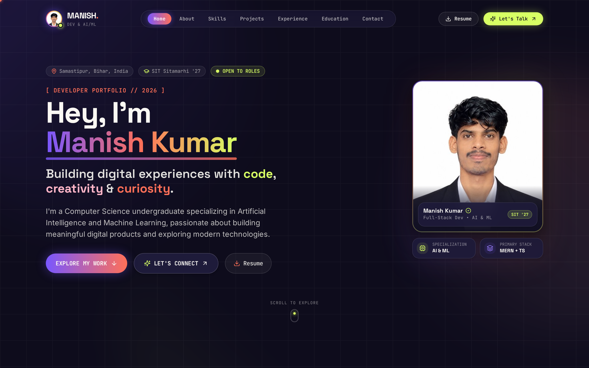
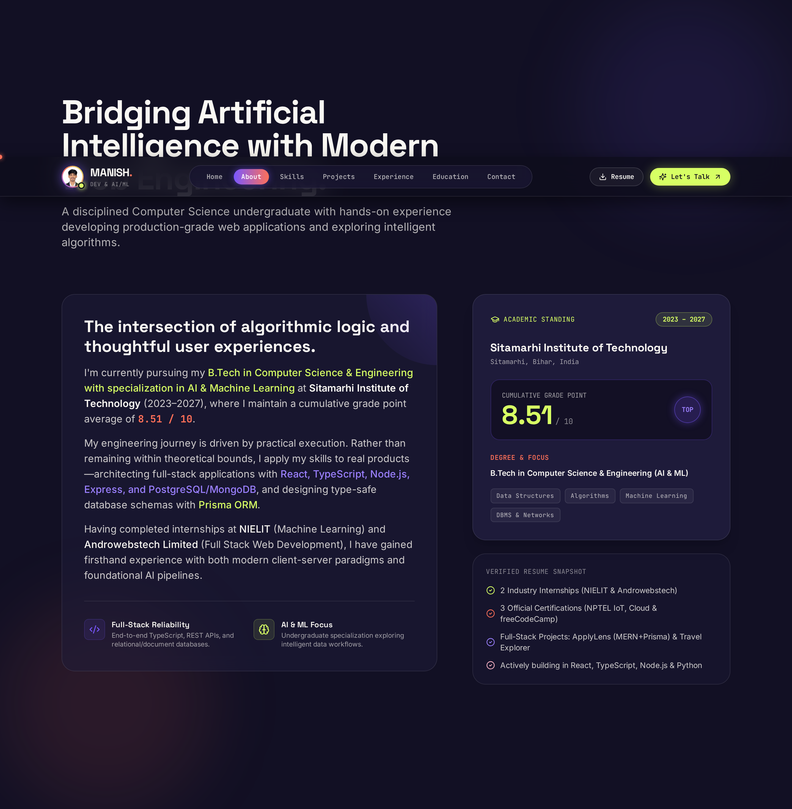
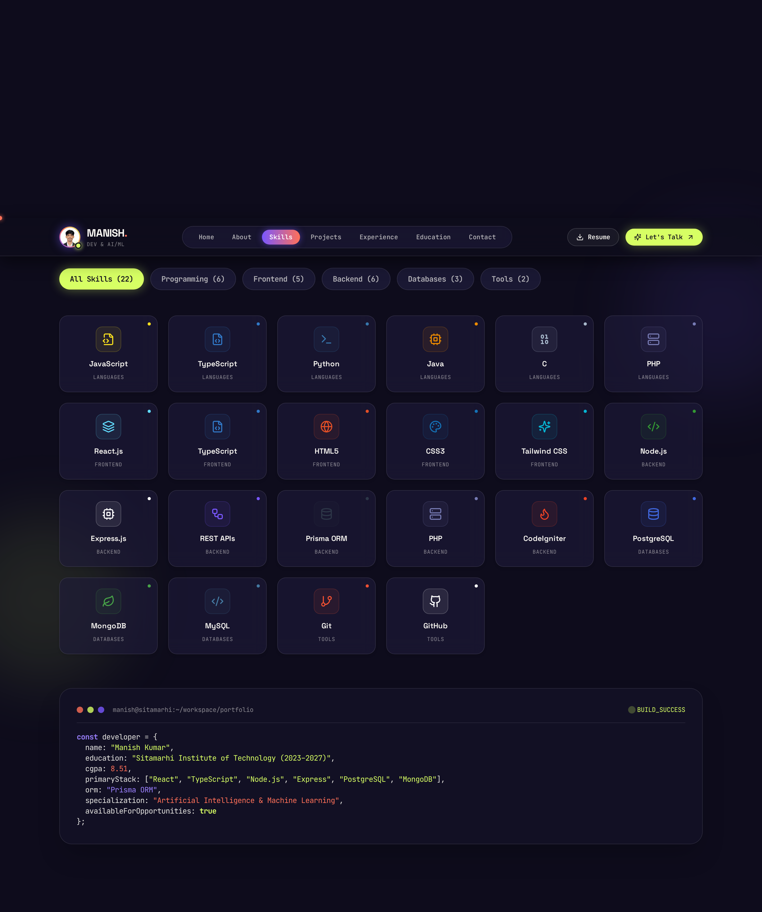
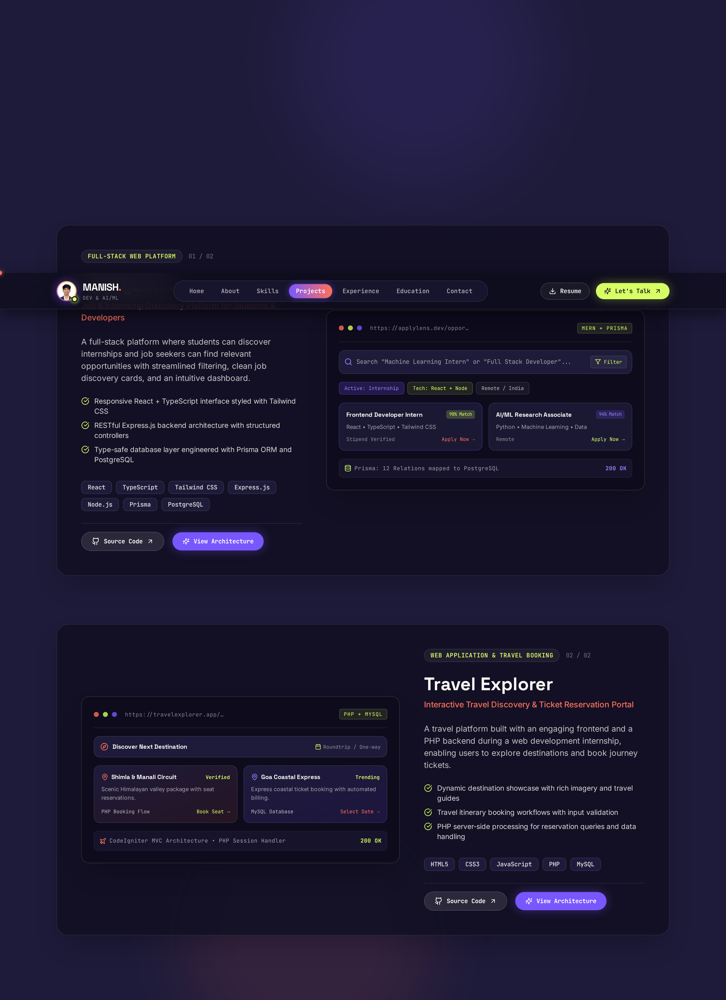
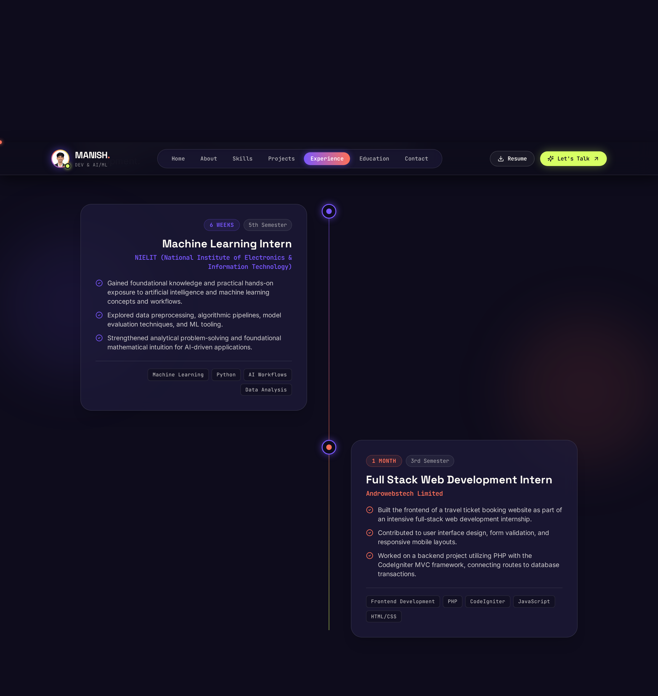
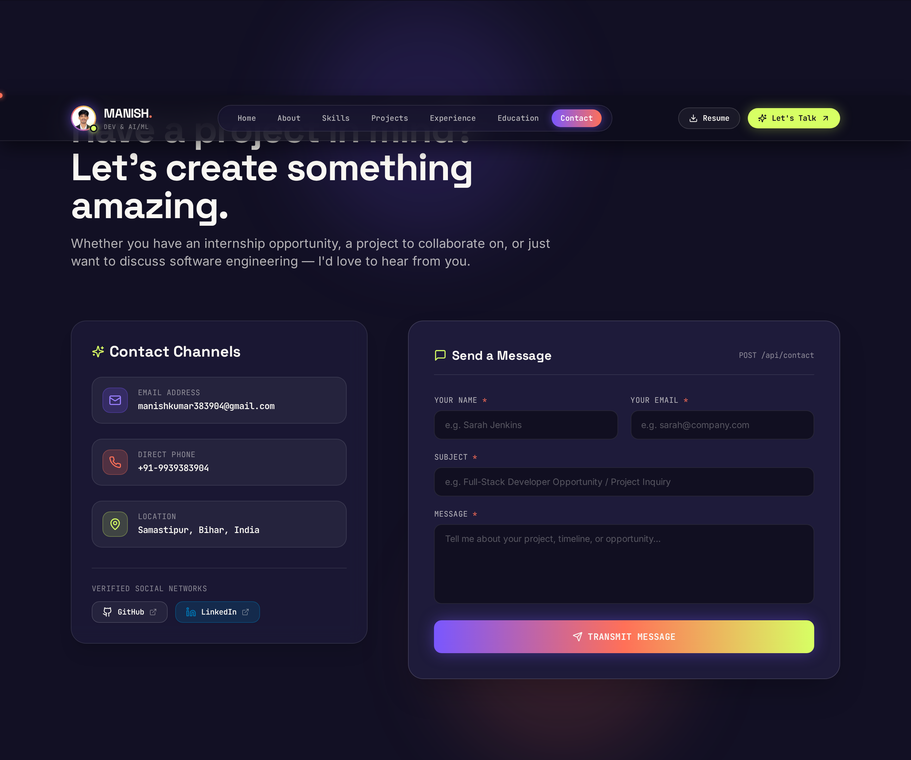

<div align="center">

# ⚡ Manish Kumar — Personal Developer Portfolio

<p align="center">
  <a href="https://portfolio-vx8y.onrender.com/" target="_blank">
    
  </a>
</p>

<p align="center">
  <strong>An award-winning caliber, creative, and animated full-stack developer portfolio.</strong>
  <br />
  Engineered with the <strong>MERN Stack (MongoDB, Express.js, React.js, Node.js)</strong>, <strong>TypeScript</strong>, and <strong>Tailwind CSS</strong>.
  <br />
  🌐 <strong>Live Website:</strong> <a href="https://portfolio-vx8y.onrender.com/"><strong>https://portfolio-vx8y.onrender.com/</strong></a>
</p>

[](https://portfolio-vx8y.onrender.com/)
[](https://www.typescriptlang.org/)
[](https://react.dev/)
[](https://vitejs.dev/)
[](https://tailwindcss.com/)
[](https://www.framer.com/motion/)
[](https://www.mongodb.com/cloud/atlas)
[](https://nodejs.org/)
[](https://expressjs.com/)

<br />



</div>

---

## 🌟 Key Highlights & Design System

- **Vibrant Color Palette**:
  - **Electric Violet (`#7957FF`)**: Primary brand accent, glowing interactive states, and neon border rings.
  - **Coral (`#FF7058`)**: High-contrast headline highlights and call-to-actions.
  - **Lime (`#D7FF64`)**: Technology badges, live availability status, and terminal highlights.
  - **Soft Pink (`#FFB6C8`)**: Ambient radial gradient mesh accents.
  - **Deep Navy (`#17152D`, `#0E0C1C`, `#121024`)**: Editorial surfaces and high-contrast dark canvas.
  - **Warm Off-White (`#FAF8F3`)**: Clean typography and readable content layers.
- **Editorial Typography**:
  - **Space Grotesk**: Oversized display headlines, case study titles, and brand logo.
  - **Inter**: Crisp, accessible editorial body text and feature descriptions.
  - **JetBrains Mono**: Technical labels, terminal badges, and metadata tags.
- **Micro-Interactions & Motion**:
  - **Custom Adaptive Cursor**: Spring-physics inner dot and trailing follower using linear interpolation (`lerp`) at 60/120fps. Morphs into an animated `VIEW` pill over project cards and expands with magnetic pull over buttons. Auto-disables on touch devices and respects `prefers-reduced-motion`.
  - **Lenis Smooth Scrolling**: Kinetic scrolling synchronized with `requestAnimationFrame`.
  - **Full-Stack Form with Gmail SMTP**: Submissions are validated with **Zod**, stored in **MongoDB Atlas**, and dispatch an automated email notification directly to Manish's Gmail inbox with a 1-click reply button.

---

## 📸 Section Walkthrough & Screenshots

### 1. Hero Section — Creative Identity
A full-screen editorial introduction featuring fluid animated gradient meshes, personal photo logo badge, verified SIT Sitamarhi credentials, and interactive call-to-actions.

<p align="center">
  
</p>

---

### 2. About Me & Academic Merit
A split editorial story highlighting Manish's Computer Science (AI & ML) background at **Sitamarhi Institute of Technology**, **8.51 / 10 CGPA** distinction standing, and core engineering philosophy.

<p align="center">
  
</p>

---

### 3. Categorized Technical Toolkit
An interactive technical skills showcase organized into *Languages*, *Frontend*, *Backend*, *Databases*, and *Tools*, featuring Lucide tech icons and a live developer workflow terminal.

<p align="center">
  
</p>

---

### 4. Featured Projects (Case Studies)
In-depth case studies for **ApplyLens** (Full-Stack Job & Internship Platform) and **Travel Explorer** (Travel Reservation Portal), complete with interactive UI mockups, tech badges, architecture modals, and GitHub links.

<p align="center">
  
</p>

---

### 5. Practical Internships & Education Timeline
An animated vertical timeline detailing Manish's industry internships at **NIELIT** (Machine Learning Intern, 6 weeks) and **Androwebstech Limited** (Full Stack Web Development Intern, 1 month).

<p align="center">
  
</p>

---

### 6. Interactive Contact Section & Live Backend API
Functional contact form with real-time validation, **Zod** schema checking, **MongoDB Atlas** persistence, and instant **Gmail SMTP** notification delivery.

<p align="center">
  
</p>

---

## 🏗️ Monorepo Architecture

```
Portfolio/
├── docs/
│   └── screenshots/            # High-resolution portfolio screenshots
│       ├── 01-hero.png
│       ├── 02-about.png
│       ├── 03-skills.png
│       ├── 04-projects.png
│       ├── 05-experience.png
│       └── 06-contact.png
│
├── client/                     # React + TypeScript + Vite Frontend
│   ├── public/
│   │   ├── favicon.svg         # SVG brand icon
│   │   ├── resume.pdf          # Manish Kumar's Resume (PDF)
│   │   └── images/             # High-res portraits & avatars
│   ├── src/
│   │   ├── components/
│   │   │   ├── animations/     # CustomCursor.tsx (trailing lerp physics)
│   │   │   ├── layout/         # Navbar.tsx (glassmorphism), Footer.tsx (live clock)
│   │   │   ├── sections/       # Hero, About, Skills, Projects, Experience, Education, Certifications, Contact
│   │   │   └── ui/             # MagneticButton.tsx, SectionHeading.tsx
│   │   ├── data/
│   │   │   └── portfolioData.ts # Centralized resume single source of truth
│   │   ├── hooks/
│   │   │   └── useLenis.ts     # Lenis smooth scrolling integration
│   │   ├── services/
│   │   │   └── api.ts          # REST API client
│   │   ├── types/
│   │   │   └── portfolio.ts    # TypeScript definitions
│   │   ├── App.tsx             # Root application
│   │   ├── index.css           # Tailwind styles & custom scrollbars
│   │   └── main.tsx            # Entry point
│   ├── package.json
│   ├── tailwind.config.js
│   └── vite.config.ts          # Proxy /api to Express backend (:5000)
│
├── server/                     # Node.js + Express + TypeScript Backend
│   ├── src/
│   │   ├── config/
│   │   │   └── db.ts           # Mongoose connection with auto-reconnect
│   │   ├── controllers/
│   │   │   ├── contactController.ts # POST submission & GET messages
│   │   │   └── healthController.ts  # GET /api/health
│   │   ├── middleware/
│   │   │   ├── errorHandler.ts # Centralized error handler
│   │   │   └── rateLimiter.ts  # Express rate limiter (anti-spam)
│   │   ├── models/
│   │   │   └── Contact.ts      # Mongoose schema
│   │   ├── routes/
│   │   │   ├── contactRoutes.ts# /api/contact routes
│   │   │   └── healthRoutes.ts # /api/health routes
│   │   ├── services/
│   │   │   └── emailService.ts # Nodemailer Gmail SMTP notification service
│   │   ├── validators/
│   │   │   └── contactValidator.ts  # Zod schema validation
│   │   └── server.ts           # Express application with Helmet & SPA fallback
│   ├── package.json
│   ├── tsconfig.json
│   ├── .env.example
│   └── .env                    # Ignored in git
│
├── .env.example
├── .gitignore
├── package.json                # Monorepo orchestration scripts
└── README.md
```

---

## 📋 Verified Resume Details (Single Source of Truth)

- **Name**: Manish Kumar
- **Degree**: B.Tech in Computer Science & Engineering (AI & ML), 2023–2027
- **College**: Sitamarhi Institute of Technology, Sitamarhi, Bihar
- **CGPA**: 8.51 / 10 (High First Class Distinction)
- **Location**: Samastipur, Bihar, India
- **Contact**: `manishkumar383904@gmail.com` • `+91-9939383904`
- **Profiles**: [GitHub](https://github.com/mannish01) • [LinkedIn](https://www.linkedin.com/in/mannish01)
- **Internships**:
  1. **NIELIT — Machine Learning Intern** (6 weeks / 5th Semester): Foundational knowledge and hands-on exposure to AI and ML concepts and workflows.
  2. **Androwebstech Limited — Full Stack Web Development Intern** (1 month / 3rd Semester): Built frontend of a travel ticket booking website; worked on backend in PHP with CodeIgniter framework.
- **Featured Projects**:
  1. **ApplyLens**: Full-stack internship & job discovery platform (React, TypeScript, Tailwind CSS, Express, Prisma, PostgreSQL).
  2. **Travel Explorer**: Travel discovery & ticket booking platform (HTML5, CSS3, JavaScript, PHP, MySQL).
- **Certifications**:
  1. NPTEL — Internet of Things (IoT)
  2. NPTEL — Cloud Computing
  3. freeCodeCamp — Responsive Web Design & JavaScript

---

## 🛠️ Quickstart & Setup Guide

### 1. Clone & Install Dependencies
```bash
git clone https://github.com/mannish01/Portfolio.git
cd Portfolio

# Install dependencies across root, client, and server
npm run install:all
```

### 2. Environment Variables Configuration
Create a `.env` file in the `server/` directory (see `server/.env.example`):
```env
PORT=5000
NODE_ENV=development

# MongoDB Atlas Connection URI
MONGODB_URI=mongodb+srv://<username>:<password>@cluster0.abcde.mongodb.net/manish_portfolio?retryWrites=true&w=majority

# Client Origin (for CORS)
CLIENT_URL=http://localhost:5173

# Email Notifications (Optional - Gmail App Password)
SMTP_HOST=smtp.gmail.com
SMTP_PORT=465
SMTP_USER=your_email@gmail.com
SMTP_PASS=your_16_digit_app_password
EMAIL_TO=your_email@gmail.com
```

### 3. Run in Development Mode
Starts both backend Express server and Vite frontend concurrently:
```bash
npm run dev
```
- **Frontend**: [http://localhost:5173](http://localhost:5173)
- **Backend API**: [http://localhost:5000](http://localhost:5000)
- **Health Check**: [http://localhost:5000/api/health](http://localhost:5000/api/health)
- **View Submitted Messages**: `npm run view:messages` or [http://localhost:5000/api/contact](http://localhost:5000/api/contact)

### 4. Build & Run for Production
```bash
# Build both frontend and backend
npm run build

# Start the unified production server (serves both React app and API on :5000)
npm start
```

### 5. 🌐 Live Production Deployment
- **Live Website**: [https://portfolio-vx8y.onrender.com/](https://portfolio-vx8y.onrender.com/)
- **Live Health Check**: [https://portfolio-vx8y.onrender.com/api/health](https://portfolio-vx8y.onrender.com/api/health)
- **Database**: Connected to MongoDB Atlas Cluster
- **Notification**: Automated Gmail SMTP delivery on form submission

---

## 📬 Contact & Connect

- 🌐 **Live Website**: [portfolio-vx8y.onrender.com](https://portfolio-vx8y.onrender.com/)
- 📧 **Email**: [manishkumar383904@gmail.com](mailto:manishkumar383904@gmail.com)
- 💼 **LinkedIn**: [linkedin.com/in/mannish01](https://www.linkedin.com/in/mannish01)
- 🐙 **GitHub**: [github.com/mannish01](https://github.com/mannish01)
- 📍 **Location**: Samastipur, Bihar, India

---

<div align="center">
  <sub>Designed & Developed with ❤️ by Manish Kumar. Built with MERN Stack + TypeScript + Tailwind CSS.</sub>
</div>
<!-- Portfolio Documentation -->

